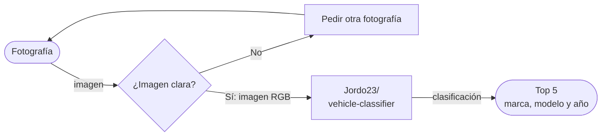

[CHESSCAR]

> [CHESSCAR ADIVINA TU CARRO EN MENOS DE LO QUE CANTA UN GALLO]

**Proyecto integrador · Herramientas de IA**

**Grupo:** [ A1 ] · **Equipo:** [ 1 ]

## 👥 Integrantes

| Nombre completo |
|-----------------|
| [DANIEL JUAREZ] | 
| [KARIM CHESSANI] | 
| [CRISTOPHER CORTÉS] | 
| [ERIK AGUIRRE] |

## 1. Caso de uso

[¿Qué necesidad resuelven y de quién es?]

Nuestro proyecto es un identifciardor de coches que les ayuda a los seguros a evalular de forma muy rápida y para anilizar diferentes coches y saber que modelo ees y en base a esos datos lo que va a hacer una cotización específica del vehículo y también se puede utilizar para identifcar coches robados pero principalmente nos basamos para la identifiación de coches, para la ayuda de los seguros y que sepan como cotizar ahorrando mucho tiempo para las aseguradoras.

- **Entrada:** [IMAGEN]
- **Salida:** [TEXTO]

Como funciona el #mermaid
flowchart LR  
A([Fotografía]) -->|imagen| B{¿Imagen clara?}  
B -->|No| C[Pedir otra fotografía]  
C --> A  
B -->|Sí: imagen RGB| E["Jordo23/ vehicle-classifier"]  
E -->|clasificación| F(["Top 5 marca, modelo y año"])

## 2. Modelo abierto elegido

| Dato | Respuesta |
|------|-----------|
| Identificador | [ [Jordo23/vehicle-classifier](https://huggingface.co/Jordo23/vehicle-classifier )  |
| Tarea (pipeline tag) | `[ `image-classification`]` |
| Número de parámetros | [$\approx$ 19M ] |
| Licencia | [MIT License ] |
| Limitación o sesgo declarado | [Condiciones de imagen: Diseñado para fotos claras y bien iluminadas; decae en tomas ocluidas o con ángulos inusuales (cenitales, primeros planos extremos). - Cobertura: Presenta fallos con autos modificados/personalizados o modelos muy antiguos y raros ausentes en VMMRdb. - Alcance: No realiza detección de color de vehículo (debe procesarse aparte).  ] |

## 3. Viabilidad de hardware

$$
\text{Memoria mínima} = 19 \times 2\ \text{bytes} \approx \ 38\ \text{aprox GB}
$$

- **VRAM disponible en Colab:** [+15 ] GB (D4])
- **Dónde se ejecuta:** [Colab con GPU]
- **Por qué:** [ Por que es gratuito ]

## 4. Riesgo ético

- **Riesgo:** [ Lo que podría pasar de los riesgos son que si este tipo de tecnología se integra con cámaras de seguridad o públicas podría utilizarse para arrastrar los trayectos de personas sin su consentimiento y otro riesgo sería fallas de reconocimiento.]
- **Mitigación:** [La solución a ese  problema es limitando el uso y a que publico esta dirigido no dirigado a todo el mundo si no a empresas específicas que cumplan con ciertas normas para poder cuidar los datos sensibles y evitar esta parte de seguir personas.]

## 5. Evidencoa
[]

