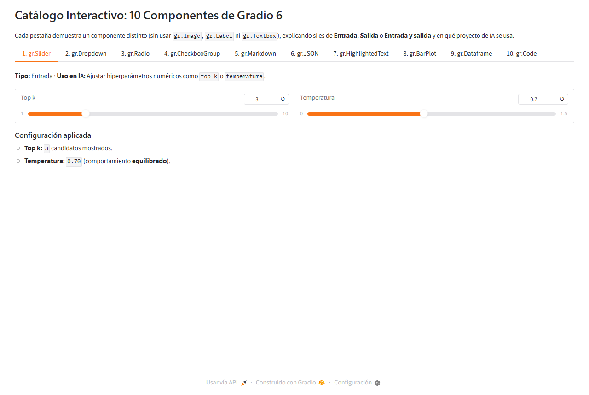
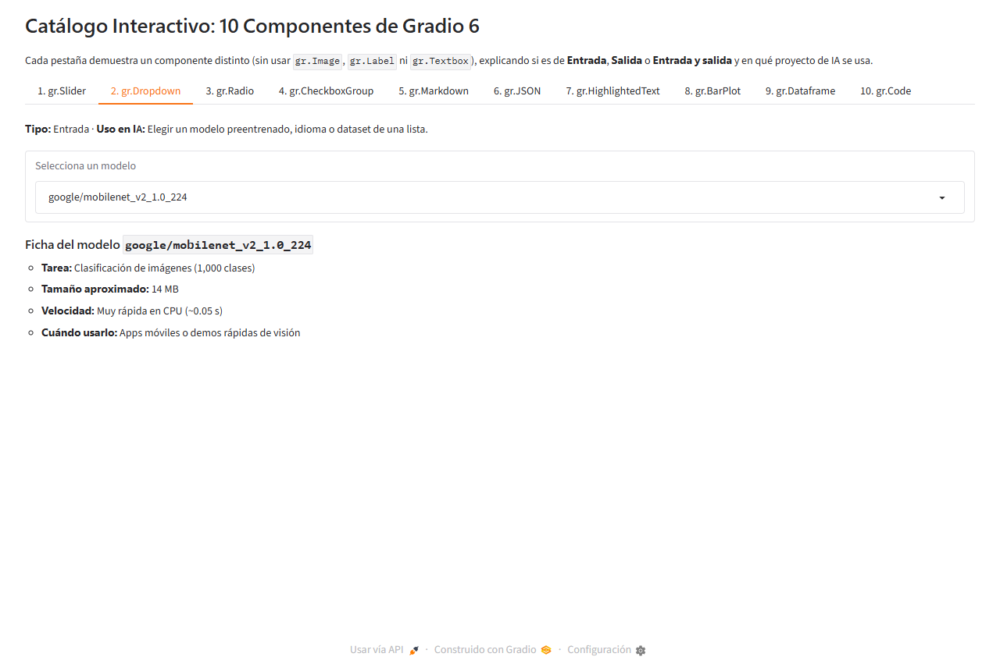
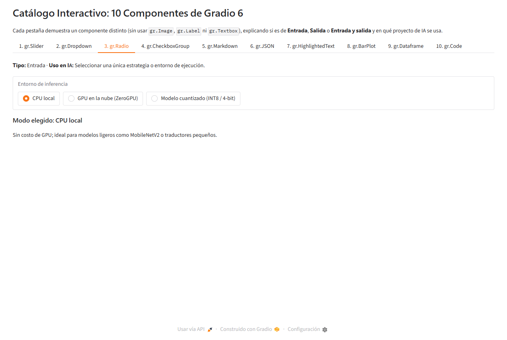
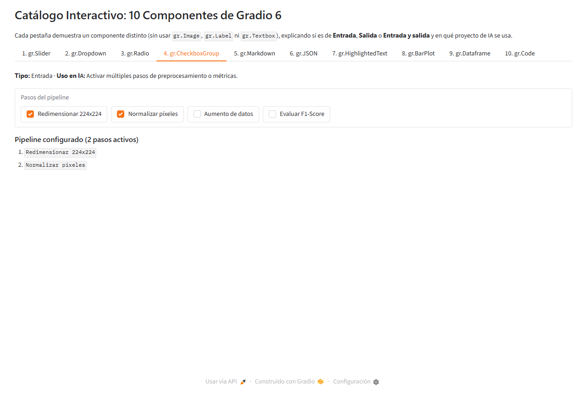
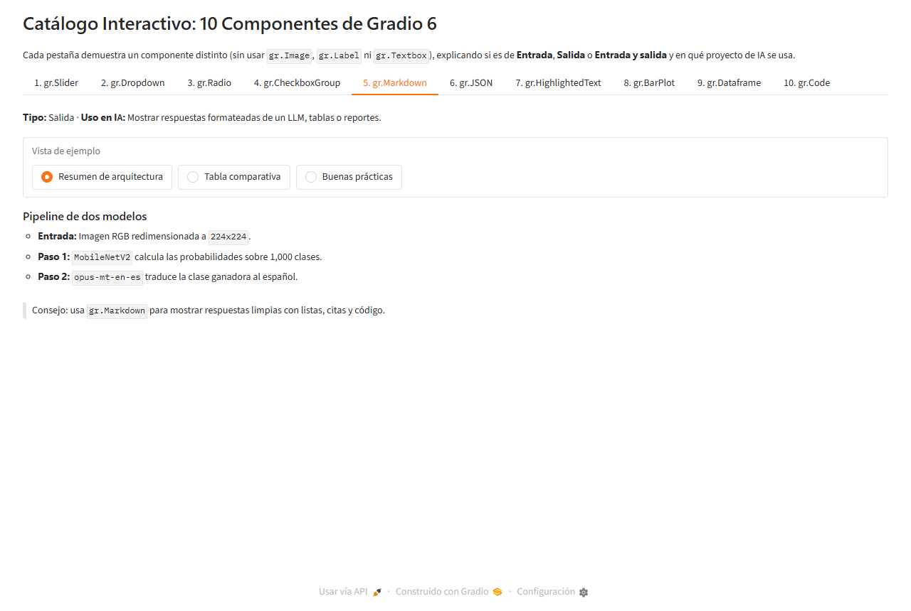
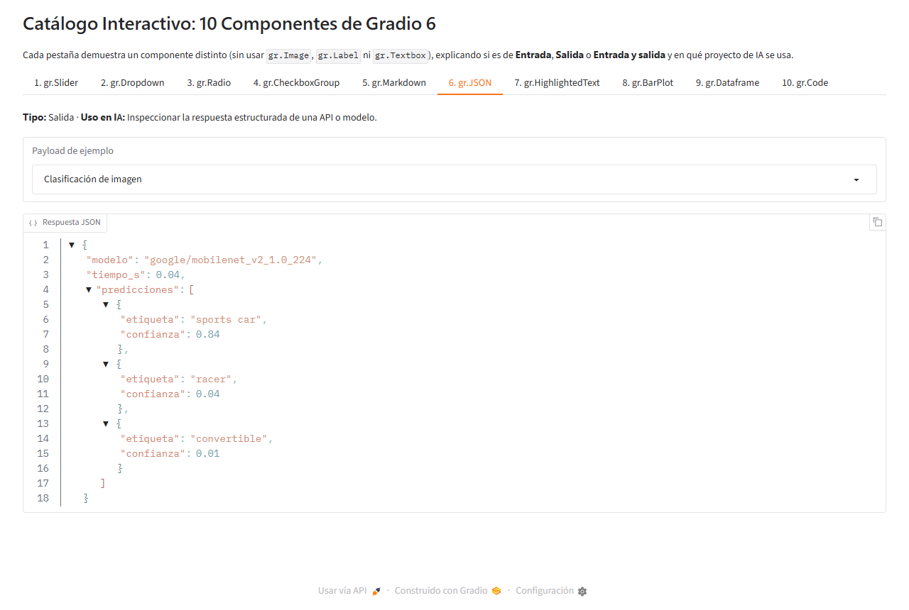
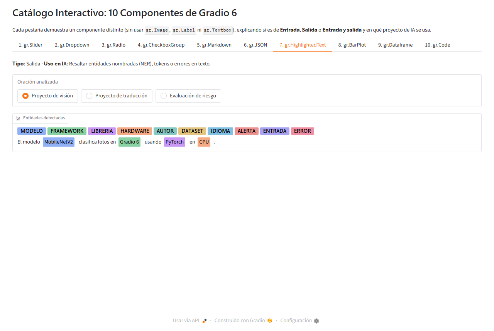
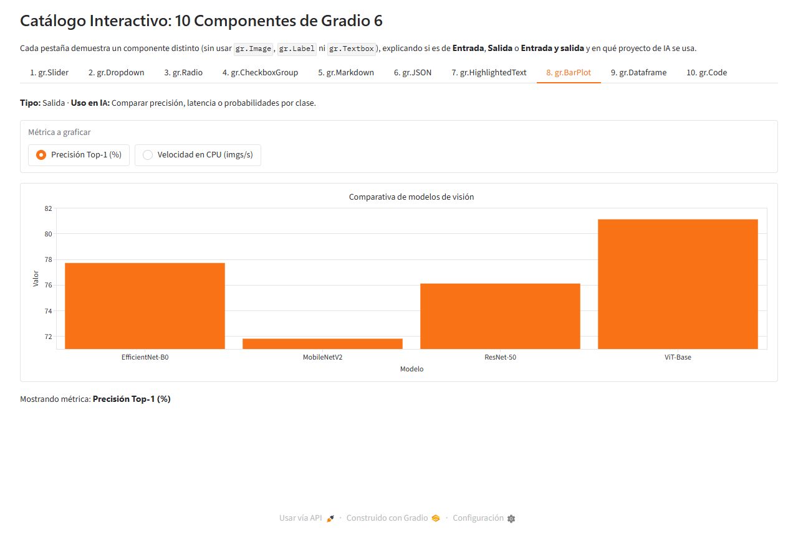
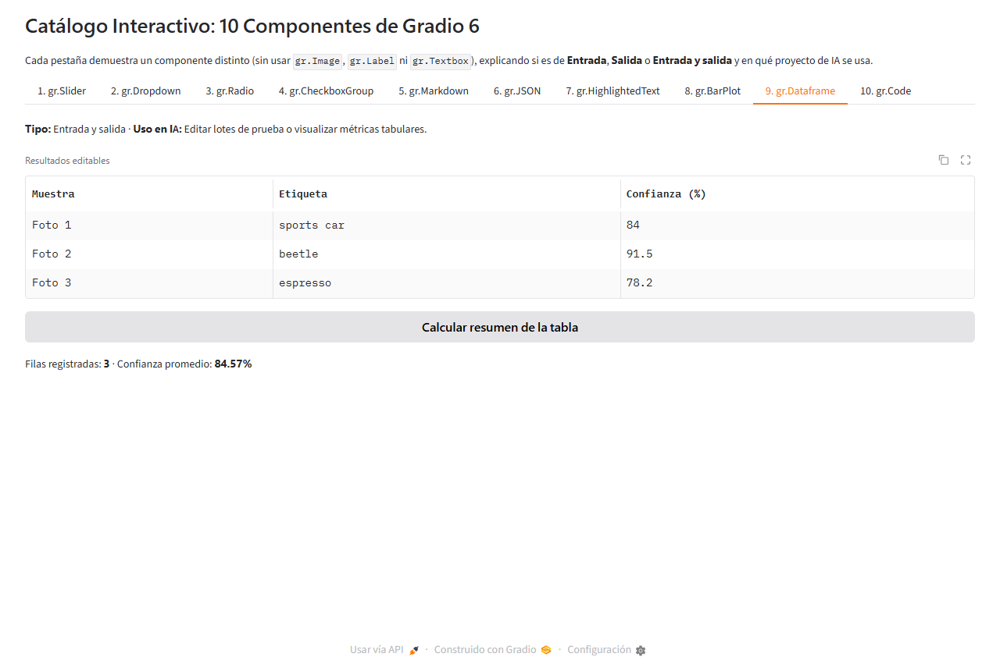
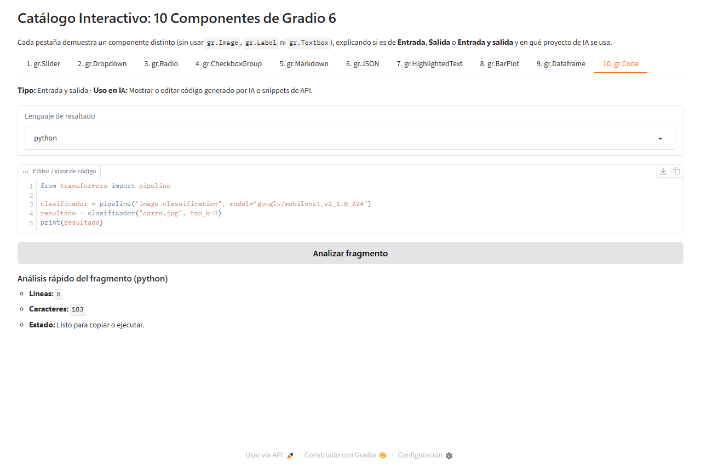

# Actividad 1 · Parcial II · Diez componentes de Gradio (App catálogo)

Aplicación interactiva construida con **Gradio 6** (`gr.Blocks` y `gr.Tabs`) que muestra **diez componentes distintos** en funcionamiento, uno por pestaña, sin reutilizar `gr.Image`, `gr.Label` ni `gr.Textbox`.

## Tabla de componentes

| # | Componente | Entrada o salida | Para qué sirve | En qué proyecto de IA lo usarías | Ejemplo de código |
|---|---|---|---|---|---|
| 1 | `gr.Slider` | Entrada | Elegir un valor numérico moviendo una barra dentro de un rango | Ajustar cuántos resultados (`top_k`) o qué `temperatura` usa un modelo | `gr.Slider(1, 10, value=3, step=1, label="Top k")` |
| 2 | `gr.Dropdown` | Entrada | Seleccionar una opción desde un menú desplegable | Elegir qué modelo preentrenado o idioma usar en la inferencia | `gr.Dropdown(choices=["mobilenet_v2", "resnet50"], value="mobilenet_v2", label="Modelo")` |
| 3 | `gr.Radio` | Entrada | Elegir una única opción entre alternativas visibles en pantalla | Seleccionar el entorno de ejecución (CPU local, GPU o modelo cuantizado) | `gr.Radio(["CPU local", "ZeroGPU"], value="CPU local", label="Entorno")` |
| 4 | `gr.CheckboxGroup` | Entrada | Activar o desactivar varias opciones al mismo tiempo | Seleccionar múltiples pasos de preprocesamiento o métricas de evaluación | `gr.CheckboxGroup(["Redimensionar", "Normalizar"], label="Pasos")` |
| 5 | `gr.Markdown` | Salida | Mostrar texto enriquecido con títulos, listas, negritas y tablas | Presentar respuestas estructuradas de un chatbot o reportes de análisis | `gr.Markdown("### Resumen del modelo\n- Latencia: 0.04 s")` |
| 6 | `gr.JSON` | Salida | Visualizar diccionarios o arreglos JSON con formato colapsable | Inspeccionar la respuesta cruda de una API de clasificación o NER | `gr.JSON(value={"etiqueta": "sports car", "confianza": 0.84})` |
| 7 | `gr.HighlightedText` | Salida | Resaltar fragmentos de texto con colores y etiquetas de categoría | Mostrar entidades nombradas (NER) o errores detectados en una frase | `gr.HighlightedText([("MobileNetV2", "MODELO")], label="Entidades")` |
| 8 | `gr.BarPlot` | Salida | Graficar barras comparativas a partir de un `DataFrame` | Comparar precisión o velocidad en CPU entre distintos modelos | `gr.BarPlot(df, x="Modelo", y="Valor", title="Comparativa")` |
| 9 | `gr.Dataframe` | Entrada y salida | Mostrar o editar datos en forma de tabla interactiva | Editar lotes de pruebas o revisar métricas tabulares de predicciones | `gr.Dataframe(headers=["Muestra", "Etiqueta", "Confianza (%)"], interactive=True)` |
| 10 | `gr.Code` | Entrada y salida | Editar o mostrar código fuente con resaltado de sintaxis | Generar fragmentos de código o probar llamadas a modelos en Python | `gr.Code(language="python", lines=6, interactive=True)` |

> Balance de componentes: **4 de entrada** (`gr.Slider`, `gr.Dropdown`, `gr.Radio`, `gr.CheckboxGroup`), **4 de salida** (`gr.Markdown`, `gr.JSON`, `gr.HighlightedText`, `gr.BarPlot`) y **2 de entrada y salida** (`gr.Dataframe`, `gr.Code`).

## Cómo ejecutar la app

```bash
cd extra-parcial-2
python -m venv .venv
# En Windows (PowerShell): .\.venv\Scripts\Activate.ps1
# En Linux/macOS: source .venv/bin/activate
pip install -r requirements.txt
python app.py
```

## Capturas de pantalla

### Vista general


### Captura por pestaña

| 1. `gr.Slider` | 2. `gr.Dropdown` |
|---|---|
|  |  |

| 3. `gr.Radio` | 4. `gr.CheckboxGroup` |
|---|---|
|  |  |

| 5. `gr.Markdown` | 6. `gr.JSON` |
|---|---|
|  |  |

| 7. `gr.HighlightedText` | 8. `gr.BarPlot` |
|---|---|
|  |  |

| 9. `gr.Dataframe` | 10. `gr.Code` |
|---|---|
|  |  |
