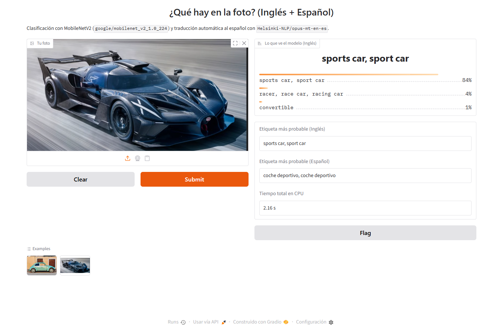

# Actividad 2 · Parcial III · Opción B: Dos modelos en una app

Extensión de la app de la Práctica 7 (`MobileNetV2`) que integra un segundo modelo de traducción automática (`Helsinki-NLP/opus-mt-en-es`) usando `AutoTokenizer` y `AutoModelForSeq2SeqLM` en `transformers` 5 para mostrar la etiqueta más probable **en inglés y en español**.

## Cómo se corre

```bash
cd extra-parcial-3
python -m venv .venv
# En Windows (PowerShell): .\.venv\Scripts\Activate.ps1
# En Linux/macOS: source .venv/bin/activate
pip install -r requirements.txt
python app.py
```

La primera vez que ejecutes `app.py`, `transformers` descargará ambos modelos desde Hugging Face (`~14 MB` para MobileNetV2 y `~300 MB` para Opus-MT). Después quedan guardados en caché local y cada inferencia en CPU toma alrededor de 1–2 segundos.

## Modelos utilizados

| Identificador | Tarea | Licencia |
|---|---|---|
| `google/mobilenet_v2_1.0_224` | Clasificación de imágenes (1,000 categorías de ImageNet) | `other` (en Hugging Face; código base de MobileNetV2 bajo Apache 2.0 y pesos entrenados con ImageNet) |
| `Helsinki-NLP/opus-mt-en-es` | Traducción automática neuronal Inglés → Español (Seq2Seq MarianMT) | `apache-2.0` |

## Captura de la app funcionando



## Tres traducciones que salieron mal y por qué

Al probar etiquetas reales de ImageNet directamente con `Helsinki-NLP/opus-mt-en-es` se observaron los siguientes errores:

1. **`"tiger cat"` → `"tigre gato"`**
   - **Por qué falla:** En inglés, el primer sustantivo modifica al segundo (`tiger` describe el patrón de rayas del `cat`). Al recibir una frase aislada de dos palabras sin contexto oracional, el traductor traduce palabra por palabra en el mismo orden en vez de reordenarlo al español como **"gato atigrado"**.

2. **`"beach wagon, station wagon, wagon, estate car, beach waggon, station waggon, waggon"` → `"vagón de playa, vagón de estación, vagón, coche de propiedad, waggon playa, waggon estación, waggon"`**
   - **Por qué falla:** Varias clases de ImageNet no son frases naturales sino listas de sinónimos separados por comas (incluyendo variantes ortográficas antiguas como `waggon`). Al no tener una oración completa que desambigüe el sentido automotriz, el modelo traduce `station wagon` de forma literal como *"vagón de estación"* (en lugar de *"camioneta familiar"* o *"vagoneta"*), `estate car` como *"coche de propiedad"* y copia `waggon` sin traducir.

3. **`"bow tie, bow-tie, bowtie"` → `"corbata de arco, corbata de arco, corbata de arco"`**
   - **Por qué falla:** La palabra inglesa `bow` es polisémica (puede significar *arco* de flecha/estructura o *moño/lazo*). Sin contexto alrededor que indique vestimenta formal, el modelo elige la traducción más literal de `bow` (*arco*), generando *"corbata de arco"* en lugar de **"corbata de moño"** o **"pajarita"**.
